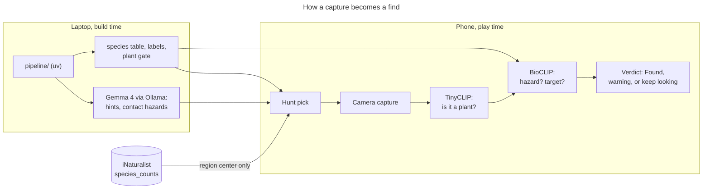

<div align="center">

# 🌿 Wild Find

[](https://github.com/anchildress1/wild-find/actions/workflows/ci.yml) [](https://github.com/anchildress1/wild-find/actions/workflows/pipeline.yml) [](https://github.com/anchildress1/wild-find/actions/workflows/codeql.yml) [](LICENSE) [](docs/PRD.md)

Wild Find sends kids 8 and up outside to find and photograph plants that grow near them. Open-weight models on the phone check each photo. No photo ever leaves the device.

**Look. Photograph. Leave it where it grows.**


</div>

## Table of contents

- [About](#about)
- [Features](#features)
- [Tech stack](#tech-stack)
- [Architecture](#architecture)
- [Project structure](#project-structure)
- [Getting started](#getting-started)
- [Configuration](#configuration)
- [Security and privacy](#security-and-privacy)
- [How to contribute](#how-to-contribute)
- [What's next](#whats-next)
- [License](#license)
- [Credits](#credits)
- [Author](#author)

---

## About

Wild Find is an Android scavenger hunt for kids, played with a parent. Each hunt picks three plants that people have actually recorded nearby this month on iNaturalist. The kid finds each one, points the camera, and taps Capture. Models on the phone check the photo, so it never leaves the device, and the app warns when a plant might hurt to touch.

It's built for the DEV [Hacktoberfest 2026 "Touch Grass" challenge](https://dev.to/devteam/join-the-hacktoberfest-open-source-ai-challenge-week-1-touch-grass-2450-in-prizes-across-17-4pom). The full spec is [docs/PRD.md](docs/PRD.md), the work queue is [docs/stories.md](docs/stories.md), and every number below comes from a dated write-up in [docs/results/](docs/results/).

---

## Features

| Feature | What it does |
| --- | --- |
| Local hunts | Three targets from what iNaturalist has recorded near your rough area this month, never two from one genus |
| Check on the phone | TinyCLIP makes sure the camera is on a plant; BioCLIP 2.5 Mobile checks it's the target. On fresh test photos 56 of 99 targets pass, and none of 267 toxic photos does (`docs/results/day-5.md`) |
| Hazard warning | A warning card for plants that hurt to touch: poison ivy, oak, and sumac across North America, plus 83 contact hazards (stinging nettle, giant hogweed, wild parsnip) wherever iNaturalist has seen them |
| Toxic plants never win | Anything flagged toxic or as a hazard is never a target, and a photo that looks too much like one never passes |
| Where-to-look hints | Up to three hints per target ("Look in some shade."), written at build time from Wikipedia and USDA data |
| Works offline | Grown-ups can cache an area's hunts for all 12 months and play without signal |
| Briar | An animated mascot who welcomes, warns, and celebrates finds |
| Grass practice | The first hunt opens with a practice find on grass; Grown-ups can repeat the intro any time |

---

## Tech stack

| Layer | What |
| --- | --- |
| App | Kotlin 2.4, Jetpack Compose, CameraX 1.6, Android 11+ (minSdk 30, targetSdk 37), AGP 9.4 |
| On-device models | [BioCLIP 2.5 Mobile](https://huggingface.co/crazedcodernate/bioclip-2.5-mobile-fastvit) (fp32) and [TinyCLIP ViT-8M/16](https://huggingface.co/wkcn/TinyCLIP-ViT-8M-16-Text-3M-YFCC15M), run by ONNX Runtime 1.30 |
| Game logic | Pure Kotlin JVM module (`core/`), every rule unit-tested |
| Build pipeline | Python with [uv](https://docs.astral.sh/uv/): species table, toxicity flags, plant types, sprites |
| Build-time model | Gemma 4 26b through [Ollama](https://ollama.com), on the laptop only: hints and the contact-hazard list |
| Data | iNaturalist, Wikipedia, USDA PLANTS, GBIF, Natural Earth |
| Tooling | Gradle, SDKMAN!, lefthook, ktlint, detekt, ruff, actionlint, gitleaks |

---

## Architecture



- **One network call:** each hunt sends iNaturalist the center of a whole-degree area and gets back what's been seen there. Nothing else leaves the phone.
- **Verify:** each Capture checks 3 frames. A hazard in the top 5 of about 4,272 known plants shows the warning. A find needs the target to beat every other local plant and lead every local toxic look-alike by a set margin, 3 frames in a row.
- **Core vs. app:** `core/` decides; `app/` draws the screens, runs the camera and models, and talks to iNaturalist.

---

## Project structure

```text
wild-find/
├── app/               Android app: Compose screens, CameraX, ONNX Runtime, iNaturalist client
│   ├── src/main/assets/   committed art, labels, and Briar's animations
│   └── generated/         bundled models and tables from `make assets` (gitignored)
├── core/              game rules in pure Kotlin: region, sightings, hunt pick, verify
├── pipeline/          uv Python build steps
│   └── data/              committed build outputs: toxicity, hints, contact hazards
├── assets/source/     original art and Briar's source videos
├── docs/
│   ├── PRD.md             spec of record
│   ├── stories.md         work queue
│   └── results/           dated measurements behind every number
└── Makefile           every build, test, and device step
```

---

## Getting started

You need SDKMAN!, the Android SDK, uv, lefthook, ktlint, detekt, actionlint, and gitleaks. A phone with USB debugging is needed for device tests.

```sh
sdk env install   # the JDK pinned in .sdkmanrc
make setup        # lefthook hooks + uv sync
make assets       # bundled models and tables; the first run pulls about 160 MB of pinned files
make ai-checks    # lint, tests, build, secret scan
make install      # debug APK to a connected phone
```

| Command | What it does |
| --- | --- |
| `make device-test` | On-device tests, apart from the end-to-end ones |
| `make e2e` | End-to-end UI tests in a separate `.e2e` app; needs signal |
| `make gate-harness` / `make gate-pull` | Logged verify, memory, and heat run on the phone, then copy the log into `docs/results/gate/` |
| `make hints`, `make contact-hazards` | Rebuild the Gemma-written data; need Ollama running `gemma4:26b`, about 90 minutes and 10 minutes |
| `make sprites` | Repack Briar's animations, the plant pictures, the title art, and the app icon from `assets/source/` |

---

## Configuration

- **Phone choice:** with more than one phone attached, set `ANDROID_SERIAL` in your shell; adb reads it.
- **Release signing:** create the key once, outside the repo:

  ```sh
  keytool -genkeypair -v -keystore ~/.android/wild-find-release.jks -alias wild-find -keyalg RSA -keysize 4096 -validity 10000
  ```

  Then add `keystore.properties` at the repo root. It's gitignored, so it never gets committed:

  ```properties
  storeFile=/Users/<you>/.android/wild-find-release.jks
  storePassword=...
  keyAlias=wild-find
  keyPassword=...
  ```

- **Release build:** `make release` writes one signed APK per phone CPU to `app/build/outputs/apk/release/`: `app-arm64-v8a-release.apk` (about 151 MB, for most phones) and `app-armeabi-v7a-release.apk` (about 141 MB, older 32-bit phones only). Without `keystore.properties` they build unsigned. Back up the key: losing it means people can't upgrade an installed copy.

---

## Security and privacy

- **Photos stay on the phone.** The found picture lives in memory for the Found screen and is never written to storage or sent anywhere.
- **No location leaves the phone.** iNaturalist only ever gets the center of a rounded whole-degree area, never the device's coordinates.
- **No accounts, analytics, crash reporting, or remote config.**
- **No language model in the app.** Gemma runs only on the laptop at build time; the phone only reads what it wrote.
- **Never a safety promise.** Kid copy never says a plant is safe, harmless, not poisonous, or okay to touch; the pipeline build and the device tests both fail on it. The hazard warning is extra caution, not a guarantee.
- **Secrets:** `gitleaks` runs on every commit and push; the release key and its properties file stay out of git.

---

## How to contribute

- Read [AGENTS.md](AGENTS.md) and [docs/PRD.md](docs/PRD.md) first; a change that contradicts the PRD updates it in the same commit.
- Branch from `main` and open a PR. Commits are signed, atomic [Conventional Commits](https://www.conventionalcommits.org/); `gitlint` checks them.
- `make ai-checks` must pass before every commit. Warnings fail the build.
- Measurements (speed, memory, accuracy) go into `docs/results/` the same day, with date, device, versions, and inputs.

---

## What's next

- **A smaller APK** (S71): store the species table at half precision, trim ONNX Runtime to the operators the models use, and lighten Briar's animations.
- **The GitHub Release** (S53): both APKs on a v0.1.0 release.
- **Hazards per continent:** the poison ivy family warns unseen only inside a North America box today; other continents rely on what iNaturalist has seen nearby.
- **Read-aloud hints:** the speaker button in the hint design waits on a decision.

---

## License

[MIT](LICENSE). Do what you like with the code: use it, change it, sell it, ship it in something bigger. Just keep the copyright notice and license text with any copy, and don't expect a warranty. The plant warnings are best effort, not a guarantee.

---

## Credits

- **Challenge:** [DEV](https://dev.to) and [MLH](https://mlh.io) for hosting the [Hacktoberfest 2026 week 1 challenge](https://dev.to/challenges/hacktoberfest-week1-2026-10-05?bb=264648)
- **Models on the phone:** [BioCLIP 2.5 Mobile](https://huggingface.co/crazedcodernate/bioclip-2.5-mobile-fastvit) and [TinyCLIP ViT-8M/16](https://huggingface.co/wkcn/TinyCLIP-ViT-8M-16-Text-3M-YFCC15M)
- **Data:** [iNaturalist](https://www.inaturalist.org), [Wikipedia](https://www.wikipedia.org), [USDA PLANTS](https://plants.usda.gov), [GBIF](https://www.gbif.org), and [Natural Earth](https://www.naturalearthdata.com)
- **Build-time only:** [BioCLIP 2.5](https://huggingface.co/imageomics/bioclip-2.5-vith14) writes the tutorial label vectors on a laptop with [OpenCLIP](https://github.com/mlfoundations/open_clip), and [Gemma 4](https://ai.google.dev/gemma) (26b, through [Ollama](https://ollama.com)) writes the hints and the contact-hazard list from Wikipedia; none of them runs in the app
- **Fonts:** [Fredoka](https://fonts.google.com/specimen/Fredoka) and [Atkinson Hyperlegible](https://fonts.google.com/specimen/Atkinson+Hyperlegible), SIL Open Font License 1.1

---

## Author

Ashley Childress · [@anchildress1](https://github.com/anchildress1) on GitHub
